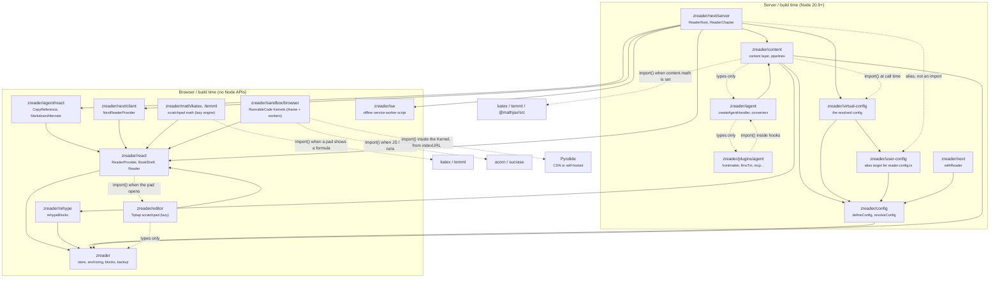
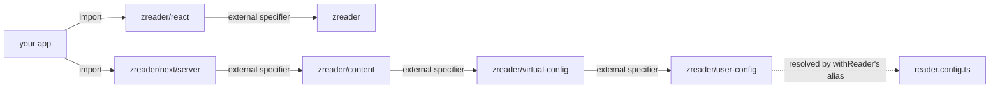
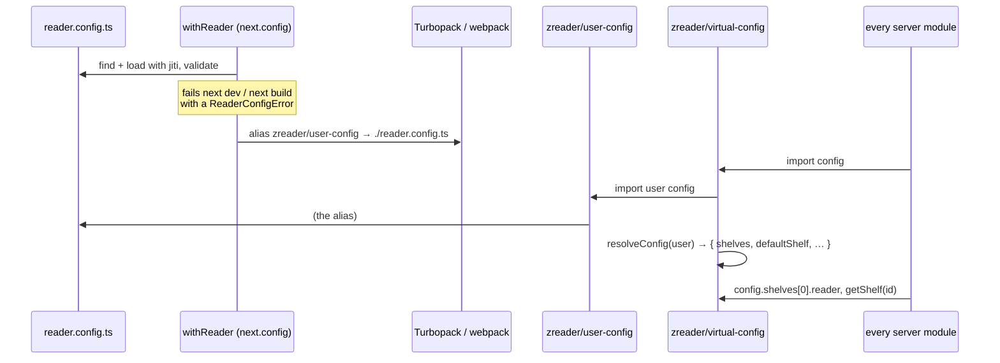
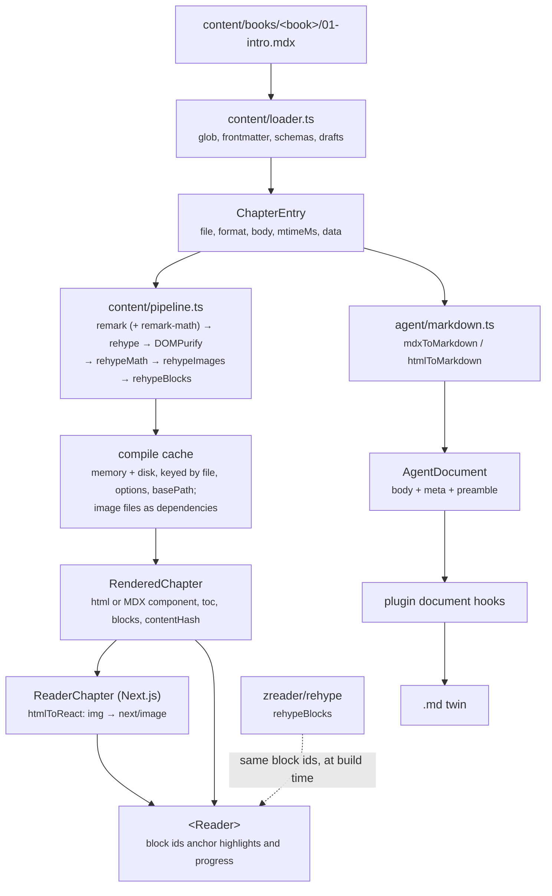
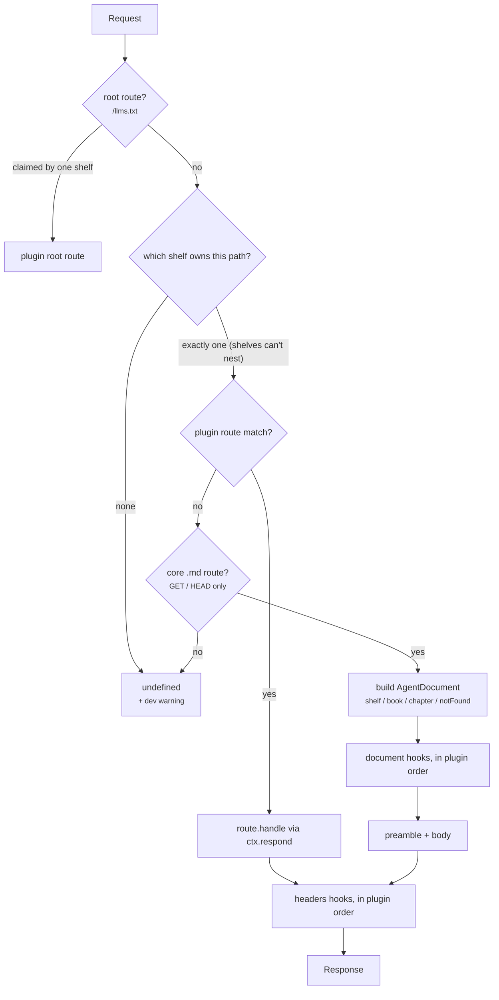
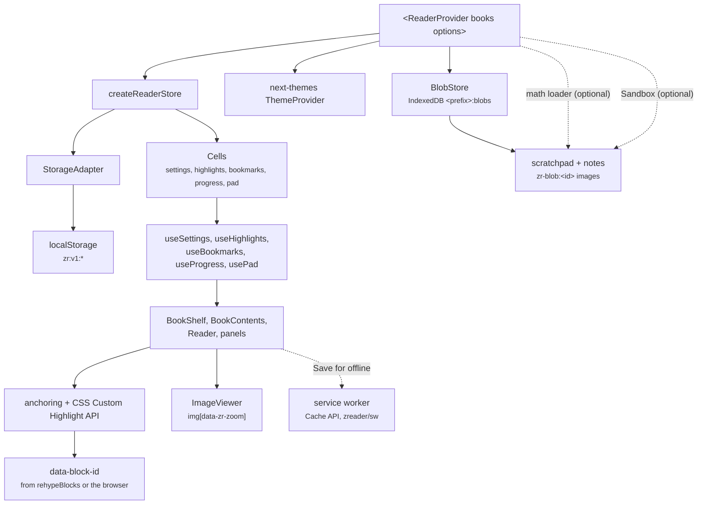
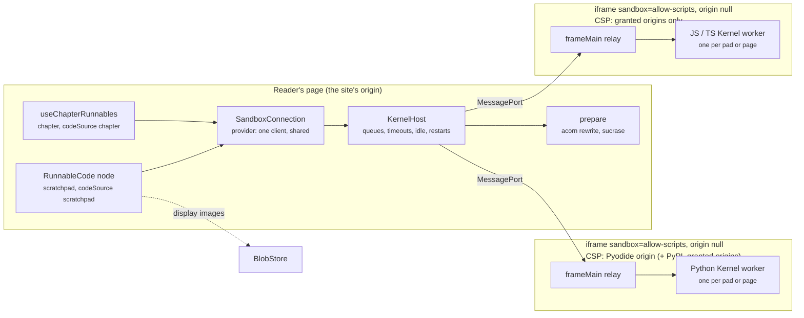
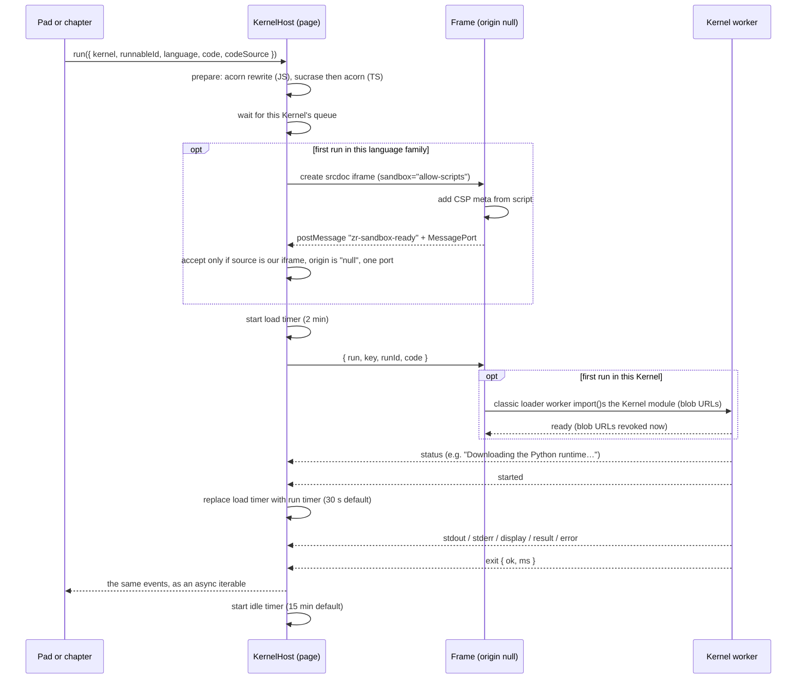

# Architecture

How zreader's pieces fit together: which entry point depends on which, where the browser/server boundary sits, and how a chapter becomes both a page and a Markdown document.

Everything here is enforced by the build, so the diagrams can't drift far: `zreader` subpaths are always external to each other, and a [build check](#build-checks) fails if a browser bundle reaches for Node or Next.js.

## The two halves

zreader is one package with several entry points. They split cleanly into what runs in the browser and what runs on the server or at build time.



Two things to read off it:

- **There is no runtime cycle.** Every dashed edge is either a type-only import or a lazy `import()`. The two that look like a loop — `zreader/agent` ↔ `zreader/plugins/agent`, and `zreader/agent` ↔ `zreader/content` — are types in both directions, so nothing is loaded at runtime.
- **The server half never reaches into the browser half.** `zreader/next/server` touches `zreader/react` only to pass component references across the RSC boundary.
- **Math engines are never bundled.** They are optional peer dependencies loaded with `import()` only when selected. On the server the imports carry `webpackIgnore` / `turbopackIgnore` comments, so an app that installed only `katex` still builds. In the browser, `zreader/math/*` is opt-in and the engine becomes its own chunk.
- **Sandbox runtimes are never bundled either.** acorn (and `sucrase`, an optional peer, for TypeScript) are code-split and load on the first JavaScript or TypeScript run. Pyodide isn't in the package at all: the Python Kernel `import()`s it from `pyodideIndexURL` inside its worker.
- **`zreader/agent` serves assets too.** It imports `serveAsset` from the content layer at runtime, so one proxy answers `.md` twins and book images.

## Subpaths never inline each other

Every `zreader/*` specifier is marked **external** in `tsup.config.ts`, so the built files reference each other by name and the *app's* bundler resolves them:



Why it matters:

- A client entry can't accidentally inline server code, and vice versa.
- `zreader/user-config` and `zreader/virtual-config` **must** be resolved by the app's bundler, because `withReader()` rewrites the alias to point at the project's `reader.config.ts`. If tsup inlined it, that rewrite would have nothing to rewrite.
- Swapping one subpath for a stub (below) works without touching the others.

The server-only subpaths carry a `browser` condition that resolves to a stub which throws, so importing `zreader/content` from a component fails loudly rather than silently pulling in `node:fs`.

## How the config reaches the code

`reader.config.ts` is written once and read everywhere — including from the proxy handler, which can't see React props. That's why it goes through an alias rather than through props.



Outside Next.js there is no alias: `zreader/user-config` discovers `reader.config.*` from `process.cwd()` and loads it with jiti itself.

`resolveConfig` produces one `ResolvedReaderConfig` holding **`shelves: ResolvedShelf[]`** — each with its own `basePath`, `content`, `reader` and `plugins`. Every surface reads from that one array: the agent handler resolves its routes from it, `ReaderRoot shelf="…"` picks one entry, `withReader` traces every entry's content folder.

## A chapter's two lives

The reader page and the `.md` twin are produced by two separate pipelines from the same file. Nothing is derived from the rendered HTML.



The order inside the page pipeline matters:

| Step | Runs | Why there |
| --- | --- | --- |
| `remark-math` | `.md`, `.mdx` (only with `content.math`) | Before MDX sees `{…}`, so TeX braces never become JavaScript |
| `rehypeRunnable` | `.md`, `.mdx` | Right after remark-rehype, while fences still carry their meta: marks RunnableCode (`data-zr-runnable`) and its author Output (`data-zr-output-for`). Before rehype-raw and the site's own rehype plugins, so a highlighter that rebuilds `pre` elements drops the markers |
| User `remarkPlugins` / `rehypePlugins` | `.md`, `.mdx` | As before; in `.md` they run before sanitizing |
| DOMPurify | `.md`, `.html` | HTML profile, plus SVG (`sanitize.svg`) and MathML (when math is on). `style` stays forbidden. In `.md` only, the RunnableCode markers are kept on `pre` with valid values |
| `rehypeMathDelimiters` | `.html` | Turns `\(…\)`, `\[…\]`, `$$…$$` into math nodes |
| `rehypeMath` | all three | **After** sanitizing: engine output is MathML that never has to pass the sanitizer's style rules |
| `rehypeImages` | all three | URL policy, data-URI limits, relative paths → `_assets` URLs, measuring, captions, `data-zr-image` / `data-zr-zoom` |
| `rehypeBlocks` | all three | Block ids, now including figures, image-only paragraphs and display math |

MDX output is not sanitized (MDX is code), so for `.mdx` the math and image steps run as rehype plugins inside `@mdx-js/mdx`.

Images next to chapters are served at `{basePath}/{book}/_assets/{hash}/{path}`, where `{hash}` comes from the file's contents. `resolveBookAsset` refuses anything outside the book folder (including symlinks), hidden files and unlisted extensions; `serveAsset` re-checks the same rules per request and sends immutable caching, `nosniff` and a strict CSP for SVG. Compiled chapters record the image files they used, so in development a changed image recompiles the chapter.

The converters stay pure — they return plain Markdown. Plugins decorate the *handler's* output, so calling `chapterToMarkdown()` yourself still gives you a clean document.

## The agent request pipeline



After plugin routes and before the `.md` routes, `GET`/`HEAD` requests under `{basePath}/{book}/_assets/` are answered by `serveAsset` (turn off with `createAgentHandler({ assets: false })`).

Plugin routes are matched before the core, which is why `POST {basePath}/mcp` never falls through to a book called `mcp`, and why `OPTIONS` on any path of the shelf reaches `cors()`.

## The client runtime



Nothing here talks to a server, except two opt-ins: the offline worker, which only fetches what a reader asks to save, and the Python Kernel, which downloads Pyodide (and any packages it imports) from `pyodideIndexURL` on its first run. The store is the only writer to `localStorage`; keys are namespaced and versioned with forward migrations, and tabs stay in sync through `storage` events.

Three stores, by kind of data:

| Data | Where | Why |
| --- | --- | --- |
| Settings, highlights, bookmarks, progress, pads | `localStorage` (`zr:v1:*`) | Small strings, synchronous reads, `storage` events for tab sync |
| Images readers add | IndexedDB (`<prefix>:blobs`), ids are content hashes | Binary and large; records refer to them as `zr-blob:<id>` |
| Saved books (offline) | Cache API (`zreader-offline-v1`) | HTTP responses; pages and `/_next/` network first, `_assets` cache first |

**Highlights and math.** Anchoring works on the rendered text (TeX annotations are `data-zr-ignore`), but `spanToText` writes formulas as `$TeX$`, and that Markdown is stored as `Highlight.text` for lists, copy, export and quotes.

**The scratchpad's Markdown.** Each editor gets its own `marked` instance, so the math tokenizers it registers never reach other Tiptap editors on the page. Images and math are atom nodes with custom views; the stored format stays Markdown.

**Optional pad features.** Features that only exist when the reader's setup provides something (math today, needing a math loader) are registered in one list, `PAD_FEATURES`. Each feature declares the node types it adds, how to spot it in Markdown, and the extensions and toolbar item it turns on. `resolvePadFeatures` turns that list into the editor's extensions and toolbar, and decides which content to load: a pad's cached JSON is used only when it was made with the same features that are on now; otherwise the editor loads the Markdown. So a pad saved with math still opens, as plain text, on a page without a math loader, and a pad saved without it is reparsed once math is turned on. A new optional feature is one more entry in the list, not new branches in the editor. RunnableCode is the second entry: it needs a Sandbox from the provider and `reader.sandbox.scopes` allowing the pad's scope.

**RunnableCode** is the scratchpad's second optional feature; how it runs is the next section.

## The browser Sandbox

RunnableCode never runs on the reader's page. The page talks to a **Sandbox** through a small protocol, and the browser Sandbox (`zreader/sandbox/browser`) runs each **Kernel** in a worker inside a hidden, sandboxed iframe. The decisions behind this are in [Design → Runnable code](./design.md#runnable-code) and ADRs [0001](./adr/0001-browser-sandbox-by-default.md)–[0003](./adr/0003-no-cross-origin-isolation-stop-restarts-kernel.md).

### Three layers



| Layer | Where | Owns |
| --- | --- | --- |
| **Protocol** | `zreader` core (`src/core/sandbox.ts`) | `SandboxClient` (`run`, `restart`, `dispose`), the `RunRequest` and `RunEvent` types, `SandboxLoader` and `connectSandbox`. Browser-safe and implementation-free, so a server Sandbox can implement the same interface later |
| **Host** | The reader's page (`host.ts`) | `KernelHost`, the `SandboxClient` the browser Sandbox returns: a queue per Kernel, the run, load and idle timers, restarts, and turning frame messages into a `RunEvent` stream per run |
| **Frame and Kernels** | Sandboxed iframes (`kernels.ts`) | `frameMain` applies the CSP and relays messages; each Kernel is a worker that runs code and posts events. No timers, no queue, no state beyond the interpreter |

The provider takes a `SandboxLoader` from its `sandbox` prop or from `<ScratchpadSandbox />` (which registers one with `useRegisterSandbox`), and wraps it in `connectSandbox` with the site's `reader.sandbox.kernel` and `permissions`. The client is created on the first run and disposed when the provider unmounts.

### Kernels

A Kernel is keyed by `(kernel, language)`, where `kernel` comes from the caller:

| Caller | `kernel` | `codeSource` | Lifetime |
| --- | --- | --- | --- |
| Scratchpad | `<pad scope>#<TAB_ID>` | `scratchpad` | Until Stop, a timeout, idle shutdown or the tab closes. Two tabs never share a Kernel |
| Chapter page | `page:<book>:<chapter>#<TAB_ID>~<visit>` | `chapter` | One page visit: restarted when the reader leaves the chapter. Never shared with a pad |

Languages share a frame by family: Python gets one iframe, JavaScript and TypeScript share another. Each Kernel inside a frame is its own worker, so restarting one is `worker.terminate()` and never touches another.

### A run, end to end



- **Preparing on the page.** JavaScript is rewritten with acorn so top-level declarations survive between runs, the last expression is returned and `import` becomes `await import()`. TypeScript has its types stripped by sucrase first. Syntax errors come back as an `error` event before anything reaches the frame.
- **Two timers.** The load timer allows for the runtime downloading; the run timer starts at the Kernel's `started` event, so a slow first Python run isn't counted against `runTimeoutMs`. Both live on the page because a worker in an infinite loop can't time itself out.
- **Restarts.** Stop, a timeout and idle shutdown all `terminate()` the worker; a worker error does the same from inside the frame. A run in progress ends with `restarted` and a reason (`stopped`, `timeout`, `crashed`); a Kernel shut down while idle reports `restarted: idle` at the start of its next run. The next run starts a fresh worker.

### Inside the frame

The frame's page and every Kernel are self-contained functions in `kernels.ts`, turned into source with `Function.prototype.toString` and passed in through `srcdoc` and blob URLs, so nothing is fetched to start them and the frame needs no URL of its own. Each step works around a browser constraint recorded in [ADR 0001](./adr/0001-browser-sandbox-by-default.md):

- The CSP is added as a `<meta>` from the frame's script, before any worker starts. A `<meta>` in `srcdoc` would rely on `'self'`, which means nothing in an opaque origin.
- A Kernel is started as a one-line classic worker that `import()`s the Kernel module from a second blob URL, because Chromium refuses module workers from blob URLs in opaque-origin iframes. Both URLs are revoked only after the Kernel posts `ready`, because Safari fails if they're revoked straight after `new Worker()`.

The CSP comes from `kernelCsp()`:

| Directive | Value | Why |
| --- | --- | --- |
| `default-src` | `'none'` | Nothing else loads |
| `script-src` | `blob: 'unsafe-eval' 'wasm-unsafe-eval'` + allowed origins | Kernels start from blob URLs, run code with `AsyncFunction` / Pyodide, and Pyodide is WebAssembly |
| `worker-src` | `blob:` | Kernel workers |
| `connect-src` | allowed origins, else `'none'` | The network boundary |

The allowed origins are per frame. The JavaScript frame gets only the origins the site granted in `dangerousPermissions.network`. The Python frame also gets the Pyodide origin (from `pyodideIndexURL`), and PyPI (`pypi.org`, `files.pythonhosted.org`) only when the site grants `packages`.

A `srcdoc` frame also inherits the host page's own CSP, and its policy can only narrow that one. A site that sends a CSP has to allow what the frame needs; see [Runnable code → Isolation](./sandbox.md#isolation).

### The Kernels

Both Kernels run a **fetch guard** before any user code. The CSP is what blocks the network; the guard makes a blocked `fetch` fail with a message naming the setting that would allow it, and rethrows every failed `fetch` as a fresh `TypeError`, because WebKit's CSP rejection otherwise hangs a Python run.

| | JavaScript / TypeScript Kernel | Python Kernel |
| --- | --- | --- |
| Runs code with | `new AsyncFunction(code)()`, so `await` works at the top level | Pyodide `runPythonAsync`, loaded from `indexURL` on the first run (`MPLBACKEND=agg`) |
| stdout / stderr | `console.log`/`info`/`debug` and `console.warn`/`error` | Pyodide's batched stdout and stderr |
| `result` | The returned last expression, formatted (`Map`, `Set`, cycles, `bigint`) | `repr()` of the last expression |
| `display` | `display(x)` for an `OffscreenCanvas`, or a PNG, JPEG, GIF or WebP `Blob` or data URL. Raster only: an SVG could run script if opened on its own | Every open Matplotlib figure, saved as PNG after the run and closed |
| Packages | Imports from granted origins | Pyodide's own packages through `loadPackagesFromImports` (from `indexURL`). `micropip.install` is wrapped to allow only the granted `packages`, by name |
| Errors | `error` with the thrown name and message | `error` with the exception type, message and traceback |

Display images arrive on the page as base64 and are stored in the BlobStore like images readers paste, so Outputs refer to them as `zr-blob:<id>`.

### Outputs and chapters

**In pads**, the RunnableCode node writes the last run's Output into the pad's Markdown as an `output for=<id>` fence after the code, with images as ``. Timing and status are not stored, and the UI marks an Output stale by comparing `codeFingerprint` of the code with the run that produced it ([ADR 0002](./adr/0002-outputs-stored-in-pad-markdown.md)).

**In chapters**, `useChapterRunnables` (used by `<Reader>`) finds `pre[data-zr-runnable]` from the content pipeline and adds one `data-zr-ignore` element after each: controls, a textarea editor and the reader's Output. The author's code and Output stay in the page, so block ids and highlights are untouched; editing hides the author's `pre` until Reset, and the chapter engine ignores mutations inside ignored elements. Nothing a reader does in a chapter is saved; Copy to pad turns the code and its Output into pad Markdown.

### Permissions, and what isn't built yet

Today both codeSources get the **scratchpad's** Dangerous permissions (`reader.sandbox.permissions.scratchpad`), passed to `frameConfig()` when a frame opens. A new set of permissions or Kernel settings creates a new client, which restarts every Kernel. The ADRs describe what comes next; none of it is in the code yet:

- **Per-chapter rules** ([ADR 0004](./adr/0004-permission-rules-match-ids-most-specific-wins.md), [#19](https://github.com/Alchemyst-ai/zreader/issues/19)): permissions matched by `bookId/chapterId` patterns, most specific rule wins.
- **Pinned chapter packages** ([ADR 0005](./adr/0005-chapter-packages-pinned-and-csp-enforced.md)): for `codeSource: chapter`, packages resolved to exact wheel URLs at build time and the CSP narrowed to those URLs, because a name check inside `micropip` doesn't stop code that fetches a wheel directly.
- **A server Sandbox** ([#16](https://github.com/Alchemyst-ai/zreader/issues/16); [ADR 0001](./adr/0001-browser-sandbox-by-default.md), [ADR 0006](./adr/0006-server-sandbox-auth-is-the-apps-job.md)): another `SandboxClient` behind a route the app mounts, with auth left to the app through an optional `authorize` callback.

## Source layout

```
src/
  core/            zreader            store, storage, anchoring, blocks, backup, blob store, types
  react/           zreader/react      provider, components, hooks, shadcn/ui parts
  editor/          zreader/editor     the Tiptap scratchpad (lazy-loaded), image and math nodes, the optional-feature registry
  math/            zreader/math/*     scratchpad math loaders (KaTeX, Temml)
  sandbox/browser/ zreader/sandbox/browser  the browser Sandbox: Kernel host, frame and Kernel workers, JS rewrite
  sw/              zreader/sw         the offline service worker script
  rehype/          zreader/rehype     rehypeBlocks
  config/          zreader/config     defineConfig, resolveConfig, bookshelves, validation
  content/         zreader/content    loader, pipeline, sanitize, images, assets, math, htmlToReact, the content API
  agent/           zreader/agent      handler, markdown converters
  plugins/agent/   zreader/plugins/agent   the agent plugins (frontmatter, llmsTxt, mcp…)
  next/            zreader/next       withReader, applyReaderConfig
  next/client/     zreader/next/client     NextReaderProvider
  next/server/     zreader/next/server     ReaderRoot, ReaderChapter, next/image, assetRoute, serviceWorkerRoute
  virtual-config/  zreader/virtual-config  the resolved config
  user-config/     zreader/user-config     alias target (or cwd discovery)
  stubs/           —                  server-only and empty-config browser stubs
```

Plugins live **beside** `src/agent/`, not inside it, so the dependency only ever points one way: `plugins/agent` → `agent`.

## Build

`tsup` builds three groups, all with every `zreader/*` specifier external:

| Group | Entries | Format |
| --- | --- | --- |
| Node, split | `core`, `content`, `next/server`, `rehype`, `sw`, `agent`, `plugins/agent`, `virtual-config`, `user-config`, `stubs` | ESM |
| Node, unsplit | `config`, `next` | ESM + CJS (loaded from `next.config.*`) |
| Browser, unsplit | `react`, `editor`, `next/client`, `agent/react`, `math/katex`, `math/temml`, `sandbox/browser` | ESM |

Then `use-client.mjs` re-adds the `"use client"` directive that Rollup drops, and the checks run.

### Build checks

| Script | Fails the build when |
| --- | --- |
| `check-bundles.mjs` | A browser bundle (`react`, `editor`, `agent/react`, `rehype`, `core`, `math/katex`, `math/temml`, `sandbox/browser`) imports `next`, `next/*` or a Node built-in |
| `check-bundles.mjs` | `zreader/plugins/agent` statically imports `unified`, `zreader/content` or `zreader/virtual-config` — `reader.config.ts` is loaded by jiti inside `next.config`, so the plugin factories must stay light |
| `publint` + `attw` | The `exports` map, types or conditions don't resolve for any consumer |

`npm test` covers the same boundaries from the other side: one test walks the static import graph out of `src/plugins/agent/index.ts`, and another runs every plugin example in [Agent plugins](./plugins.md).

The [examples](../examples) are the integration check that unit tests can't be: both build against the local package, and the Next.js one exercises the proxy, `_assets`, `next/image`, math, offline reading and RunnableCode in pads and chapters in a real browser. The Sandbox also has its own check across real browsers (see [Runnable code → Checking it in real browsers](./sandbox.md#checking-it-in-real-browsers)).

## Further reading

- [Design](./design.md) — why it works this way, and the trade-offs

- [Concepts](./concepts.md) — the catalogue, ids and URLs, block ids, server vs client
- [Configuration](./configuration.md#bookshelves) — bookshelves, the unit every surface reads from
- [Agent-readable content](./agent.md) — the handler and its routes
- [Agent plugins](./plugins.md) — the pipeline and how to extend it
- [Images](./images.md), [Math](./math.md) — the two content pipelines added in 0.4
- [Runnable code](./sandbox.md) — configuring the Sandbox; [ADRs](./adr/) for why it's built this way
- [API reference](./api-reference.md) — every entry point and its exports
