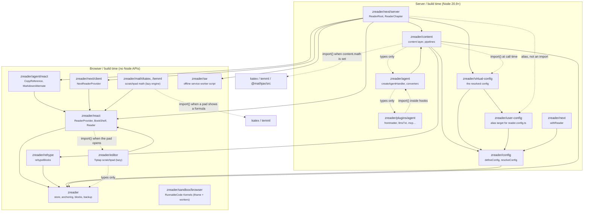
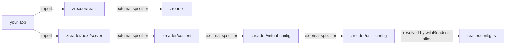
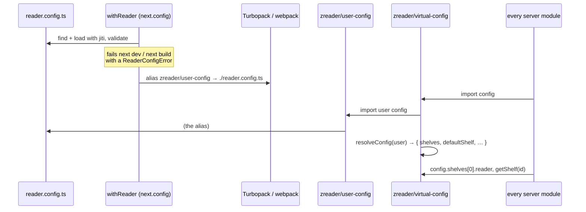
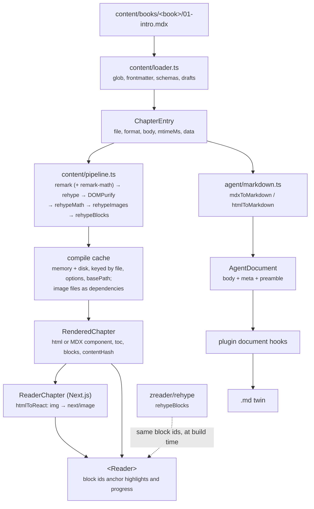
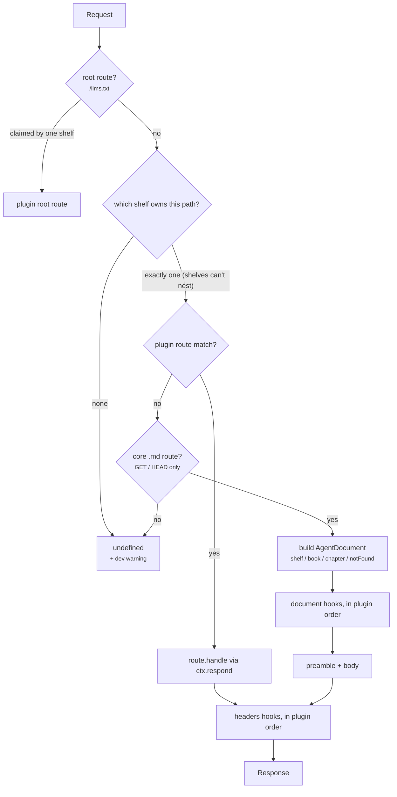
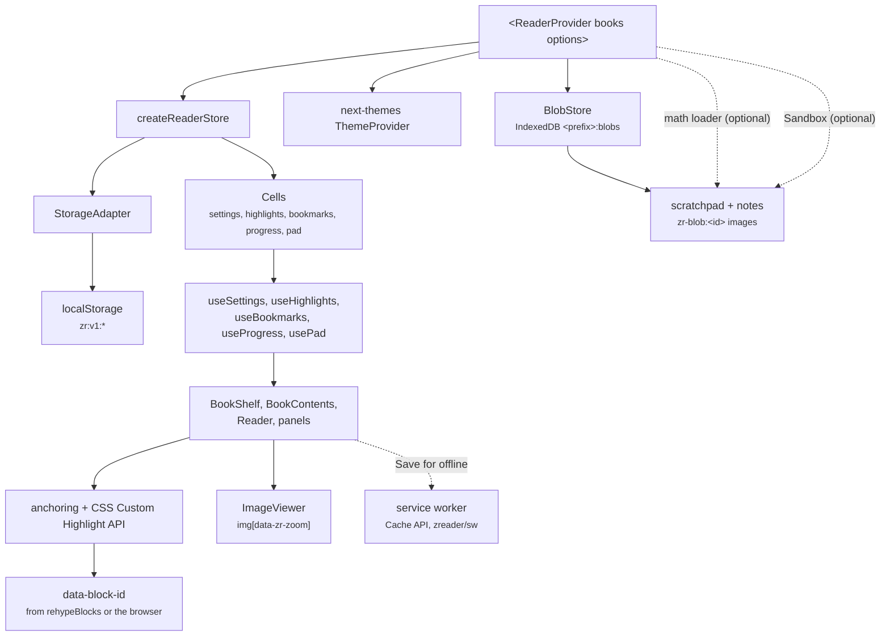
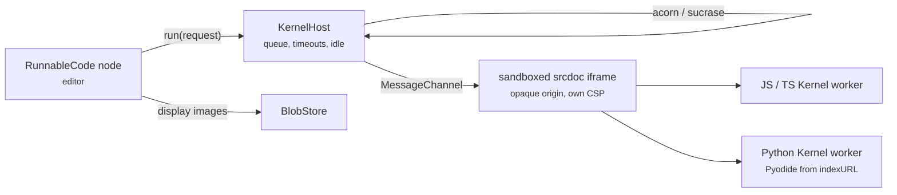

# Architecture

How zreader's pieces fit together: which entry point depends on which, where the browser/server boundary sits, and how a chapter becomes both a page and a Markdown document.

Everything here is enforced by the build, so the diagrams can't drift far: `zreader` subpaths are always external to each other, and a [build check](#build-checks) fails if a browser bundle reaches for Node or Next.js.

## The two halves

zreader is one package with several entry points. They split cleanly into what runs in the browser and what runs on the server or at build time.



Two things to read off it:

- **There is no runtime cycle.** Every dashed edge is either a type-only import or a lazy `import()`. The two that look like a loop — `zreader/agent` ↔ `zreader/plugins/agent`, and `zreader/agent` ↔ `zreader/content` — are types in both directions, so nothing is loaded at runtime.
- **The server half never reaches into the browser half.** `zreader/next/server` touches `zreader/react` only to pass component references across the RSC boundary.
- **Math engines are never bundled.** They are optional peer dependencies loaded with `import()` only when selected. On the server the imports carry `webpackIgnore` / `turbopackIgnore` comments, so an app that installed only `katex` still builds. In the browser, `zreader/math/*` is opt-in and the engine becomes its own chunk.
- **`zreader/agent` serves assets too.** It imports `serveAsset` from the content layer at runtime, so one proxy answers `.md` twins and book images.

## Subpaths never inline each other

Every `zreader/*` specifier is marked **external** in `tsup.config.ts`, so the built files reference each other by name and the *app's* bundler resolves them:



Why it matters:

- A client entry can't accidentally inline server code, and vice versa.
- `zreader/user-config` and `zreader/virtual-config` **must** be resolved by the app's bundler, because `withReader()` rewrites the alias to point at the project's `reader.config.ts`. If tsup inlined it, that rewrite would have nothing to rewrite.
- Swapping one subpath for a stub (below) works without touching the others.

The server-only subpaths carry a `browser` condition that resolves to a stub which throws, so importing `zreader/content` from a component fails loudly rather than silently pulling in `node:fs`.

## How the config reaches the code

`reader.config.ts` is written once and read everywhere — including from the proxy handler, which can't see React props. That's why it goes through an alias rather than through props.



Outside Next.js there is no alias: `zreader/user-config` discovers `reader.config.*` from `process.cwd()` and loads it with jiti itself.

`resolveConfig` produces one `ResolvedReaderConfig` holding **`shelves: ResolvedShelf[]`** — each with its own `basePath`, `content`, `reader` and `plugins`. Every surface reads from that one array: the agent handler resolves its routes from it, `ReaderRoot shelf="…"` picks one entry, `withReader` traces every entry's content folder.

## A chapter's two lives

The reader page and the `.md` twin are produced by two separate pipelines from the same file. Nothing is derived from the rendered HTML.



The order inside the page pipeline matters:

| Step | Runs | Why there |
| --- | --- | --- |
| `remark-math` | `.md`, `.mdx` (only with `content.math`) | Before MDX sees `{…}`, so TeX braces never become JavaScript |
| User `remarkPlugins` / `rehypePlugins` | `.md`, `.mdx` | As before; in `.md` they run before sanitizing |
| DOMPurify | `.md`, `.html` | HTML profile, plus SVG (`sanitize.svg`) and MathML (when math is on). `style` stays forbidden |
| `rehypeMathDelimiters` | `.html` | Turns `\(…\)`, `\[…\]`, `$$…$$` into math nodes |
| `rehypeMath` | all three | **After** sanitizing: engine output is MathML that never has to pass the sanitizer's style rules |
| `rehypeImages` | all three | URL policy, data-URI limits, relative paths → `_assets` URLs, measuring, captions, `data-zr-image` / `data-zr-zoom` |
| `rehypeBlocks` | all three | Block ids, now including figures, image-only paragraphs and display math |

MDX output is not sanitized (MDX is code), so for `.mdx` the math and image steps run as rehype plugins inside `@mdx-js/mdx`.

Images next to chapters are served at `{basePath}/{book}/_assets/{hash}/{path}`, where `{hash}` comes from the file's contents. `resolveBookAsset` refuses anything outside the book folder (including symlinks), hidden files and unlisted extensions; `serveAsset` re-checks the same rules per request and sends immutable caching, `nosniff` and a strict CSP for SVG. Compiled chapters record the image files they used, so in development a changed image recompiles the chapter.

The converters stay pure — they return plain Markdown. Plugins decorate the *handler's* output, so calling `chapterToMarkdown()` yourself still gives you a clean document.

## The agent request pipeline



After plugin routes and before the `.md` routes, `GET`/`HEAD` requests under `{basePath}/{book}/_assets/` are answered by `serveAsset` (turn off with `createAgentHandler({ assets: false })`).

Plugin routes are matched before the core, which is why `POST {basePath}/mcp` never falls through to a book called `mcp`, and why `OPTIONS` on any path of the shelf reaches `cors()`.

## The client runtime



Nothing here talks to a server, except the opt-in offline worker, which only fetches what a reader asks to save. The store is the only writer to `localStorage`; keys are namespaced and versioned with forward migrations, and tabs stay in sync through `storage` events.

Three stores, by kind of data:

| Data | Where | Why |
| --- | --- | --- |
| Settings, highlights, bookmarks, progress, pads | `localStorage` (`zr:v1:*`) | Small strings, synchronous reads, `storage` events for tab sync |
| Images readers add | IndexedDB (`<prefix>:blobs`), ids are content hashes | Binary and large; records refer to them as `zr-blob:<id>` |
| Saved books (offline) | Cache API (`zreader-offline-v1`) | HTTP responses; pages and `/_next/` network first, `_assets` cache first |

**Highlights and math.** Anchoring works on the rendered text (TeX annotations are `data-zr-ignore`), but `spanToText` writes formulas as `$TeX$`, and that Markdown is stored as `Highlight.text` for lists, copy, export and quotes.

**The scratchpad's Markdown.** Each editor gets its own `marked` instance, so the math tokenizers it registers never reach other Tiptap editors on the page. Images and math are atom nodes with custom views; the stored format stays Markdown.

**Optional pad features.** Features that only exist when the reader's setup provides something (math today, needing a math loader) are registered in one list, `PAD_FEATURES`. Each feature declares the node types it adds, how to spot it in Markdown, and the extensions and toolbar item it turns on. `resolvePadFeatures` turns that list into the editor's extensions and toolbar, and decides which content to load: a pad's cached JSON is used only when it was made with the same features that are on now; otherwise the editor loads the Markdown. So a pad saved with math still opens, as plain text, on a page without a math loader, and a pad saved without it is reparsed once math is turned on. A new optional feature is one more entry in the list, not new branches in the editor. RunnableCode is the second entry: it needs a Sandbox from the provider and `reader.sandbox.scopes` allowing the pad's scope.

**RunnableCode.** The scratchpad talks to a `SandboxClient` (the protocol in `zreader` core), which the provider loads once from its `SandboxLoader`, hands the site's `reader.sandbox` settings, and disposes on unmount. The browser Sandbox is one client:



The page side owns everything with state (the run queue per Kernel, the run timeout, idle shutdown), so the frame only starts, stops and relays workers. Its code and the Kernels are self-contained functions turned into source with `toString()`, so nothing is fetched to start them.

## Source layout

```
src/
  core/            zreader            store, storage, anchoring, blocks, backup, blob store, types
  react/           zreader/react      provider, components, hooks, shadcn/ui parts
  editor/          zreader/editor     the Tiptap scratchpad (lazy-loaded), image and math nodes, the optional-feature registry
  math/            zreader/math/*     scratchpad math loaders (KaTeX, Temml)
  sandbox/browser/ zreader/sandbox/browser  the browser Sandbox: Kernel host, frame and Kernel workers, JS rewrite
  sw/              zreader/sw         the offline service worker script
  rehype/          zreader/rehype     rehypeBlocks
  config/          zreader/config     defineConfig, resolveConfig, bookshelves, validation
  content/         zreader/content    loader, pipeline, sanitize, images, assets, math, htmlToReact, the content API
  agent/           zreader/agent      handler, markdown converters
  plugins/agent/   zreader/plugins/agent   the agent plugins (frontmatter, llmsTxt, mcp…)
  next/            zreader/next       withReader, applyReaderConfig
  next/client/     zreader/next/client     NextReaderProvider
  next/server/     zreader/next/server     ReaderRoot, ReaderChapter, next/image, assetRoute, serviceWorkerRoute
  virtual-config/  zreader/virtual-config  the resolved config
  user-config/     zreader/user-config     alias target (or cwd discovery)
  stubs/           —                  server-only and empty-config browser stubs
```

Plugins live **beside** `src/agent/`, not inside it, so the dependency only ever points one way: `plugins/agent` → `agent`.

## Build

`tsup` builds three groups, all with every `zreader/*` specifier external:

| Group | Entries | Format |
| --- | --- | --- |
| Node, split | `core`, `content`, `next/server`, `rehype`, `sw`, `agent`, `plugins/agent`, `virtual-config`, `user-config`, `stubs` | ESM |
| Node, unsplit | `config`, `next` | ESM + CJS (loaded from `next.config.*`) |
| Browser, unsplit | `react`, `editor`, `next/client`, `agent/react`, `math/katex`, `math/temml`, `sandbox/browser` | ESM |

Then `use-client.mjs` re-adds the `"use client"` directive that Rollup drops, and the checks run.

### Build checks

| Script | Fails the build when |
| --- | --- |
| `check-bundles.mjs` | A browser bundle (`react`, `editor`, `agent/react`, `rehype`, `core`, `math/katex`, `math/temml`, `sandbox/browser`) imports `next`, `next/*` or a Node built-in |
| `check-bundles.mjs` | `zreader/plugins/agent` statically imports `unified`, `zreader/content` or `zreader/virtual-config` — `reader.config.ts` is loaded by jiti inside `next.config`, so the plugin factories must stay light |
| `publint` + `attw` | The `exports` map, types or conditions don't resolve for any consumer |

`npm test` covers the same boundaries from the other side: one test walks the static import graph out of `src/plugins/agent/index.ts`, and another runs every plugin example in [Agent plugins](./plugins.md).

The [examples](../examples) are the integration check that unit tests can't be: both build against the local package, and the Next.js one exercises the proxy, `_assets`, `next/image`, math and offline reading in a real browser.

## Further reading

- [Design](./design.md) — why it works this way, and the trade-offs

- [Concepts](./concepts.md) — the catalogue, ids and URLs, block ids, server vs client
- [Configuration](./configuration.md#bookshelves) — bookshelves, the unit every surface reads from
- [Agent-readable content](./agent.md) — the handler and its routes
- [Agent plugins](./plugins.md) — the pipeline and how to extend it
- [Images](./images.md), [Math](./math.md) — the two content pipelines added in 0.4
- [API reference](./api-reference.md) — every entry point and its exports
